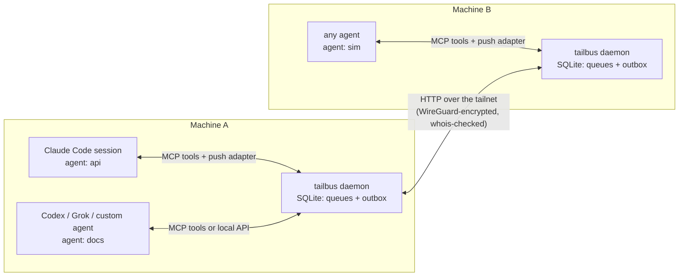
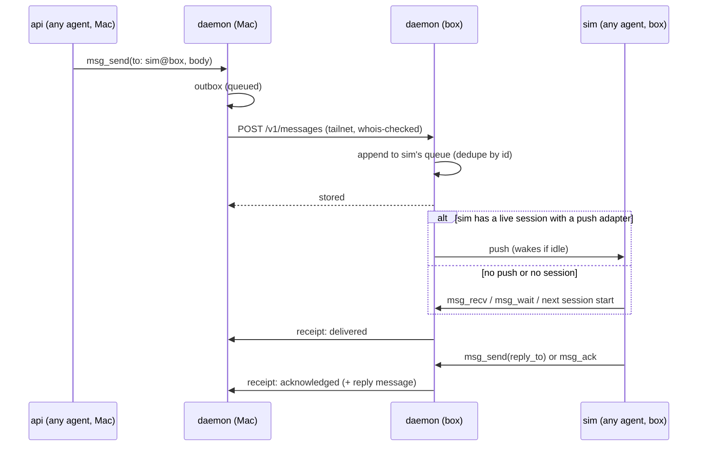

# tailbus: agent-to-agent messaging over a tailnet

Status: phase 1 built and tested; phases 2 to 4 are plans.

## Goal

Any AI agent, from any provider, on any machine on the tailnet, can send a
direct message to any other agent subscribed to the bus. Messages queue
until the recipient takes them. Where the recipient's agent app allows it,
messages are pushed into the running session, waking it if it's idle.

- **No polling, no public server.** Nothing to sign in to beyond Tailscale.
- **Accounts and providers don't matter.** Agents on different Claude
  accounts, or from different providers, talk the same way.
- **Version 1 is direct messages, queued.** Shared boards come later.

## Why not something that exists

- **Claude Code's `SendMessage` across machines** reaches only Claude Code
  sessions on the same claude.ai account. It goes through Anthropic's
  servers, holds about 100 messages, and keeps no history.
- **grayboard** is one machine only in local mode. Its distributed mode is a
  central server with Google sign-in. We take its delivery and attention
  lessons, not its architecture.
- **A broker such as Redis or NATS** is a central server to run and keep up.
  It's a single point of failure, a laptop can't queue outgoing messages
  while away from it, and it has its own user and password system that
  ignores Tailscale identity. Redis's default persistence can also lose the
  last second of messages in a crash. Decision 2 copies Redis Streams'
  queue model without running Redis.

## Design at a glance



## Decisions

Each decision has a short why, so it survives later simplification.

1. **One bus per machine, no central server.** Each machine's bus owns the
   queues of the agents subscribed on it. Sending writes the message to the
   sender's outbox, and the bus forwards it to the recipient's machine,
   retrying until that machine has stored it.
   - *Why:* laptops sleep and servers reboot. A message waits until the
     other machine is back, and nothing hangs on one always-on host.
   - *Cost:* shared boards will need one machine to own each board
     (phase 4).
2. **The queue model is Redis Streams', stored in SQLite.** Each agent gets
   an append-only queue.
   - The recipient's session reads from its cursor. Each message it's given
     goes on a *pending* list until it's acknowledged.
   - Messages still pending when a session ends are redelivered to the
     agent's next session.
   - IDs are time-ordered unique IDs (ULIDs), generated without
     coordination. Receivers ignore duplicates, so retries are safe and
     delivery is exactly-once in practice.
   - *Why:* it's the queue model you were reaching for with Redis, without
     running Redis.
3. **Agents subscribe under a name; provider and account don't matter.** An
   agent's address is `name@machine`, for example
   `sim@box`.
   - An agent subscribes when its session first connects, or ahead of time
     with `tailbus agent add <name>`. Either way a queue exists, so messages
     can wait before the agent first runs.
   - Sending to an unknown agent is an error that points to `peer_list`,
     never a silent drop.
   - The bus records each agent's app, from the name the app gives the MCP
     server when it connects, and optionally its provider and model. These
     are for display only; the bus never routes on them.
   - The name defaults to the repository the session runs in, plus the
     worktree name inside a worktree. `TAILBUS_AGENT` overrides it. Two apps
     open in the same repository therefore want the same name, and decision
     11 refuses the second with a hint to set `TAILBUS_AGENT`.
   - Names use only lowercase letters, digits and hyphens, so a name can't
     carry text into a notice.
4. **Agents connect in layers,** so any agent works and better-integrated
   ones get more:

   | Layer | Works with | What it gives |
   | --- | --- | --- |
   | Local API and CLI | anything that can open a Unix socket or run a command: scripts, custom agents on any provider's SDK | Send, receive, acknowledge. `tailbus recv --wait` blocks until a message arrives. |
   | MCP tools | nearly every agent app (Claude Code, Codex, Gemini CLI, opencode, Cursor, …) | The tool set below, including `msg_wait`, which blocks until a reply arrives. |
   | Push adapter | agent apps that let an outside process inject into a running session | Messages appear in the conversation without the agent asking, and wake an idle session. |
   | Bot runner | agent apps with a headless mode that resumes a session, and plain provider APIs | tailbus runs the agent itself, one turn per message. Nobody needs a terminal open. See [Bots](#bots). |

   Push adapters are per agent app (decision 5). Without one, an agent still
   gets every message, through its tools and through a "you have mail" note
   at session start where the app supports one.
5. **Claude Code's push adapter must work on any account.**
   - **Default:** a background hook (`asyncRewake`) armed at session start
     and after every turn. It waits on the local bus. When a message
     arrives, it exits in the way that wakes Claude Code, and the message
     appears in the session. The bus allows one waiting hook per agent, and
     a newer one replaces an older one. This needs no channels, no
     allowlist and no confirmation dialog.
   - **Optional upgrade:** Claude Code channels, where an account allows
     them. They give richer tagging and tighter integration, but are a
     research preview with a confirmation dialog unless allowlisted.
   - **Other apps:** each gets the push its app allows. Codex and Grok Build
     come first; see [Agent apps](#agent-apps). grayboard's opencode, pi and
     omp adapters are there to learn from when those apps come later.
6. **Identity comes from Tailscale.** Every incoming connection is checked
   with Tailscale's `whois`, which names the connecting machine and the
   account that owns it.
   - By default, only machines owned by the same Tailscale account as this
     one are accepted. An allowlist adds others, which is how accounts can
     differ across machines.
   - Locally, the Unix socket accepts only processes running as the same OS
     user, which the bus checks on each connection.
   - The receiving bus overwrites the sender's machine with what `whois`
     reports, so a sender can't claim to be on another machine.
   - *Why:* WireGuard already proves who each machine is, so no tokens are
     needed.
7. **The bus listens only on the machine's tailnet address**, never on all
   addresses. Tailscale access rules can narrow it further to the bus's
   port.
8. **Senders can see four delivery states:**
   - *Queued:* still in this machine's outbox.
   - *Stored:* the recipient's machine has it.
   - *Delivered:* tailbus has handed it to a session.
   - *Acknowledged:* the recipient replied in the thread or marked it
     handled.

   Receipts travel back the same way messages do.
   - *Why:* grayboard's worst bug class was "delivered" meaning nothing.
9. **Delivered means a session took it,** through a tool call, a push
   adapter that confirmed the hand-off, or the local API. A push with no
   confirmation leaves the message pending, so it reappears in the inbox
   rather than being lost.
10. **Agents' attention is protected.** Only messages addressed to the agent
    are pushed. No "you have unread messages" notices and no presence
    changes are pushed in v1.
    - Some apps can only be told that mail is waiting (Codex and Grok
      Build; see [Agent apps](#agent-apps)). They get a fixed one-line
      notice naming the sender, never the body, and at most one at a time.
      The agent reading its mail clears it.
    - *Why:* every pushed byte costs the agent's context.
11. **One live session per agent name per machine.** A new session first
    checks whether the current holder still answers. If it does, the new
    session is refused; if it doesn't, the new session takes over.
    - *Why:* two sessions holding one name was how grayboard silently lost
      messages.
12. **Messages from other agents are untrusted.** Each delivered message is
    tagged with the sending agent, its machine, and the owner Tailscale
    confirmed. Agents are told that bus messages are requests from other
    agents, not instructions from their user.
13. **Implementation:**
    - One Rust binary, like tailhop.
    - SQLite in WAL mode for storage.
    - State directory with permissions `0700`, files `0600`.
    - Acknowledged messages are pruned after 30 days, configurable.
    - Messages are kept until acknowledged, however old.

## Components

| Piece | Role |
| --- | --- |
| `tailbus daemon` | One per machine, run as a user service (launchd or systemd). Owns the database and serves the local API on a Unix socket and the API between machines on the tailnet address. Forwards the outbox, sends receipts, redelivers pending messages, pushes notices, and runs bots. |
| `tailbus mcp` | The MCP server an agent app starts for each session. Subscribes the session's agent name and provides the tools. Its process living is what makes the session live (decision 11). |
| `tailbus hook` | Hook commands for each app: `session-start` (subscribe, record the session ID, note waiting mail), `wait` (Claude Code's background hook that waits for the next message) and `stop` (Codex and Grok Build: carry on if mail is waiting). |
| `tailbus setup claude\|codex\|grok` | Writes the app's MCP config, hooks and plugin, and says what's left to do by hand, such as trusting the hooks. |
| `tailbus bot` | `add`, `list`, `remove` and `log` for [bots](#bots). |
| `tailbus` CLI | `send`, `recv [--wait \| --follow]`, `ack`, `inbox`, `agent add/list`, `peers`, `status` and `tail`. `--follow` prints a one-line notice per message, for Grok Build's monitor. |

## Message lifecycle



If the box is asleep, the message waits in the Mac's outbox. The Mac's
bus retries with backoff, and immediately once Tailscale reports the box
online again.

## Protocol between machines

The connection is plain HTTP/1.1 with JSON bodies, carried over the tailnet,
which encrypts it.

| Endpoint | Purpose |
| --- | --- |
| `POST /v1/messages` | Up to 100 messages. The reply lists the IDs stored, duplicates included, so the sender can stop retrying. |
| `POST /v1/receipts` | Delivered or acknowledged notices for messages this machine sent. |
| `GET /v1/agents` | Agents subscribed on this machine, whether each has a live session, and how long since it last had one. |

A message carries:

| Field | Meaning |
| --- | --- |
| `id` | Time-ordered unique ID |
| `from` | Sending agent, as `name@machine` |
| `to` | Recipient agent, as `name@machine` |
| `body` | Up to 64 KiB of text |
| `reply_to` | ID of the message it answers, if any |
| `expects_reply` | Whether the sender is waiting on an answer |
| `created_at` | When it was sent |

## Agent tools (MCP)

Tool names follow grayboard's `<noun>_<verb>` convention. The set stays
small, because every tool costs every session context.

| Tool | Does |
| --- | --- |
| `msg_send(to, body, reply_to?, expects_reply?)` | Sends a message and returns its delivery state. Warns when the recipient hasn't had a session in a long time, which usually means a misaddress. |
| `msg_recv(max?)` | Takes the next messages from this agent's queue. They stay pending until acknowledged. |
| `msg_wait(timeout?)` | Blocks until a message arrives or the timeout passes. Lets an agent without push wait for a reply in a single call instead of polling. |
| `msg_ack(id)` | Marks a message handled without replying. |
| `msg_inbox()` | Lists what's still owed: pending messages to you, plus your sent messages that are queued or unanswered. For use after `/clear` or a restart. |
| `msg_thread(id)` | Shows a whole thread. |
| `peer_list()` | Lists agents across machines, whether each is live, and its provider if recorded. |

The server's instructions to the agent fit in 512 characters, because Codex
advises that the first 512 stand on their own (Claude Code allows 4,096).
They say who the agent is on the bus, that bus messages come from other
agents rather than the user, and to call `msg_inbox` at the start of a
session.

## Agent apps

What each first-target app allows, checked against its documentation and
source in October 2026, and how tailbus uses it.

| | Claude Code | Codex | Grok Build |
| --- | --- | --- | --- |
| Installed by `tailbus setup` as | a Claude Code plugin: MCP server and hooks | `[mcp_servers.tailbus]` and hooks in `~/.codex/` | a Grok plugin: MCP server, Stop hook and a skill |
| Mail note at session start | SessionStart hook | SessionStart hook | Not possible; SessionStart output is ignored. The MCP instructions say to call `msg_inbox`. |
| Wakes an idle session | `asyncRewake` hook (decision 5) | `codex queue` | The `monitor` tool, which the agent starts |
| Long `msg_wait` | to verify | `tool_timeout_sec` | `tool_timeouts` |
| Bot turns | `claude -p --resume` | `codex exec resume` | `grok -p --resume` |

### Claude Code

- Push works as decision 5 says.
- The hooks ship in a plugin, not in `settings.json`, because Grok Build
  also runs the hooks in Claude Code's `settings.json`. `tailbus hook` also
  does nothing unless Claude Code's `CLAUDECODE` variable is set.

### Codex

- **MCP config:**

  ```toml
  [mcp_servers.tailbus]
  command = "tailbus"
  args = ["mcp"]
  tool_timeout_sec = 660                  # longer than msg_wait's longest wait
  default_tools_approval_mode = "approve"
  ```

  - The timeout has to be set: the docs say the default is 60 seconds and
    the 0.164.0 source says 300.
  - `codex exec` denies every tool call that needs approval, so without
    `approve` a bot couldn't reply. `approve` lets Codex send bus messages
    without asking; a person who wants to be asked can set `msg_send` alone
    back to `prompt`.
- **Session start:** a command hook adds "N messages waiting" to the
  context and tells the bus the session's thread ID. Codex runs a hook only
  once you've trusted it in `/hooks`, which `tailbus setup codex` says to
  do.
- **Push:** `codex queue --thread <id> --message "<notice>"`. Codex starts a
  turn with it at once if the session is idle, or after the current turn.
  The agent then calls `msg_recv`, which marks the message delivered.
  - The notice never contains the body, because Codex treats queued text as
    if the user typed it. The body arrives through `msg_recv`, framed as
    untrusted (decision 12).
  - It only reaches sessions on Codex's shared background server, which the
    TUI uses by default but not with `--no-daemon`, `-c` overrides or
    `--profile`. For those sessions, the Stop hook does the job instead: a
    turn that ends with mail waiting continues with the notice. An idle
    session isn't woken.
  - A queued notice for a closed session is never dispatched, so the bus
    queues one only while the session's `tailbus mcp` process is alive.
  - `codex queue` is documented, but the server method behind it is marked
    experimental.
- **Not usable:** Codex's background hooks are documented never to start a
  turn, so there's no `asyncRewake` equivalent. Codex ignores custom MCP
  notifications, so there are no channels either.

### Grok

"Grok bots" can mean four things.

1. **Grok Build** (`grok`), xAI's official agent CLI, in beta. This is the
   main target.
   - **MCP config,** or `grok mcp add tailbus -- tailbus mcp`:

     ```toml
     [mcp_servers.tailbus]
     command = "tailbus"
     args = ["mcp"]
     tool_timeouts = { msg_wait = 900 }
     ```

     Grok reaches MCP tools through its `search_tool` and `use_tool`, as
     `tailbus__msg_send` and so on.
   - **Push.** Grok Build's hooks can't add text at session start or on a
     prompt, so the plugin combines two things:
     - *Idle wake:* Grok's `monitor` tool turns each line a command prints
       into a notification that can start a turn. The plugin's skill tells
       the agent to start `tailbus recv --follow` as a persistent monitor.
       This depends on the agent doing as told, so `msg_inbox` stays the
       fallback.
     - *End of turn:* a Stop hook that, when mail is waiting, returns
       `block` with the notice, so the agent reads its mail before stopping.
   - **Config cross-talk.** Grok Build also loads Claude Code's MCP servers
     (`~/.claude.json`, `.mcp.json`) and the hooks in its `settings.json`.
     The MCP servers are welcome: a Grok session in a repo set up for
     Claude Code gets the bus tools for free. The hooks are why Claude
     Code's adapter lives in a plugin.
   - **Bot turns:** `grok -p --resume <session> --output-format json`, with
     the prompt from `--prompt-file`.
2. **Grok Bot,** xAI's hosted bots, in beta since August 2026. Each runs on
   a cloud computer xAI provides, and there's no documented API or webhook
   for sending one a message. A Bot could join only if its computer joined
   the tailnet, which xAI's enterprise setup allows, and ran tailbus there.
   Out of scope for now.
3. **A custom bot on the xAI API.** The bot runner can do this itself,
   without any agent app: on each message it calls the Responses API
   (`https://api.x.ai/v1/responses`), declares the bus tools as functions,
   and runs the calls Grok makes. It continues the conversation with
   `previous_response_id`, one per thread, and rebuilds context with
   `msg_thread` once xAI deletes the stored response after 30 days.
   - Not through the xAI API's remote MCP: xAI's servers make that
     connection, and they reject private addresses, so the bus would have
     to be exposed to the internet.
4. **superagent-ai/grok-cli,** an unaffiliated CLI that also installs as
   `grok` and also uses `~/.grok/`. It has MCP tools and a headless mode
   that resumes sessions, but its hooks can't add context. Tools and bot
   turns only. `tailbus setup grok` checks which `grok` is installed before
   writing any config.

## Bots

A bot is an agent the bus runs itself, so it answers messages with nobody
at a terminal.

- `tailbus bot add <name> --app claude|codex|grok|xai --dir <path>`
  subscribes `<name>` and says which app answers for it, in which
  directory.
- When a message arrives, the runner starts one headless turn of the app
  that resumes the bot's own session (see the [table](#agent-apps)). The
  message is the prompt, framed as untrusted (decision 12). It goes in by
  file or stdin, never on the command line, where other users of the
  machine could read it.
- The turn's final answer goes back as the reply, unless the agent already
  replied with `msg_send` during the turn.
- One turn runs at a time per bot. Messages that arrive meanwhile wait, and
  the next turn takes all of them.
- A bot's session belongs to the bus. The runner never resumes a session
  someone has open, because two writers on one session corrupt it.
- **Permissions:** a bot does whatever its app's settings allow, for anyone
  who can message it. By default the runner allows the bus tools and
  read-only file access only. Anything more is an explicit option on
  `tailbus bot add`.
- **Cost:** every turn re-reads the session's history. Grok Build's ACP
  server, Codex's app-server and the Claude Agent SDK keep a session open
  between turns instead. The runner can switch to them later (phase 3).

## Security model

- **Transport:** WireGuard (Tailscale) between machines, and a Unix socket
  limited to your OS user on each machine.
- **Who can send:** machines owned by the same Tailscale account by default,
  plus an explicit allowlist. Each message records the sender's machine and
  owner as Tailscale reported them.
- **What a message can do:** become text in the recipient's conversation,
  nothing more. Agent apps keep their own permission prompts in force.
  A message to a bot also starts a turn with nobody watching, which is why
  bots get read-only access unless given more.
- **Not defended:** a compromised machine on your own tailnet. It already
  has your Tailscale identity.

## Phases

1. **The bus, with Claude Code at both ends:**
   - The daemon, SQLite queues, and the protocol between machines with
     `whois` checks.
   - The local API and CLI, the MCP tools, and the Claude Code plugin with
     hook-based push.
   - A launchd unit.
   - Proven between this Mac and `server` (see
     [First target](#first-target)).
2. **Codex and Grok:**
   - `tailbus setup codex` and `tailbus setup grok`, with push through
     `codex queue`, and through Grok Build's monitor and Stop hook.
   - The bot runner for Claude Code, Codex and Grok Build, and the `xai`
     bot on the xAI API.
   - A systemd unit, for Linux machines.
3. **More apps and reach:**
   - Push adapters for other agent apps.
   - Claude Code channels as an option.
   - Bots that keep a session open between turns.
   - Agents on other tailnets, through tailhop's per-tailnet daemons.
   - Tracking promised replies, and retention controls.
4. **Shared work:** boards and claims, each owned by one machine.

## Risks and things to verify before building

- **Claude Code hook-based push.** Tested on Claude Code 2.1.309 (phase 1).
  - Works: a hook armed at session start and after every turn wakes an
    idle session, and doesn't hold up the session's start. Claude Code
    shows the message as "Stop hook feedback".
  - `claude -p` waits for a running `asyncRewake` hook instead of exiting,
    so the hook stands down when `CLAUDE_CODE_SESSION_ATTENDED` is `0`.
    That variable isn't documented; if it changes, headless runs with the
    plugin hang.
  - Killing Claude Code leaves the hook running. It watches its parent and
    exits once Claude Code is gone, so it can't take messages for a dead
    session.
  - Still open: whether Claude Code honors the hook's 7-day timeout. After
    it passes, an idle session isn't woken until its next turn.
- **macOS:**
  - Under launchd, the Tailscale app's binary acts as the CLI only when a
    shell starts it, so the daemon runs it through `/bin/sh`.
  - Overwriting a running or ad-hoc-signed binary in place gets it killed
    on its next start. Upgrades replace it by rename, as `cargo install`
    does.
- **Codex push** rests on `codex queue`, whose server method is marked
  experimental. Verify on the installed version that it wakes an idle
  session, and keep the Stop hook as the fallback. Also verify that a
  10-minute `msg_wait` completes.
- **Grok Build push** rests on the agent starting its monitor when the
  skill says to. Measure how reliably it does, and whether the monitor
  survives compaction. Also check whether Grok Build loads Claude Code
  plugins as well as `settings.json`.
- **Grok Build is in beta,** and a community CLI shares its binary name and
  `~/.grok/`.
- **Other agent apps' push abilities vary.** Some can only take messages
  through tools or at session start. Before promising push for an app,
  check its current documentation for hooks or extensions.
- **MCP protocol versions.** Claude Code's current MCP client won't register
  a channel server that negotiates the 2026-07-28 revision. This matters
  only for the optional channel adapter, and `tailbus mcp` can negotiate an
  older revision.
- **Other tailnets.** Verify that a userspace tailscaled passes incoming
  connections to the machine's local listener.

## First target

- **Agent apps:** Claude Code, Codex, and Grok, meaning Grok Build sessions
  and bots: Grok Build bots, and the `xai` bot on the xAI API. xAI's hosted
  Grok Bot is out of scope (see [Grok](#grok)).
- **First test:** this Mac (`you`) and `server` (`dana`), both on
  tailnet `example` and both running Claude Code 2.1.309. A Claude Code
  session on each end sends a message, gets a reply, and gets woken while
  idle.
  - **Passed on 2026-10-23.** An idle session on `server` was woken by
    a question from this Mac and answered with `msg_send`. The idle session
    here was woken by the answer, then acknowledged it. Each hop took a few
    seconds.
- **Not installed yet:** neither machine has Codex or Grok Build. Phase 2
  needs at least one of them installed and signed in on at least one
  machine; over ssh, `codex login --device-auth` and
  `grok login --device-auth` sign in without a browser. The `xai` bot needs
  only an xAI API key.
